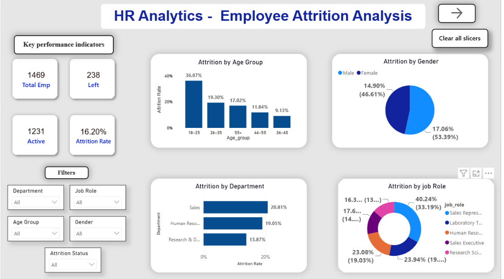
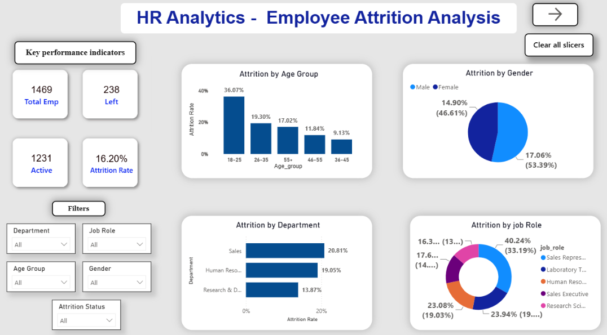

# HR Employee Attrition Analysis | MySQL & Power BI

## Tools & Technologies

| Tool / Technology | Purpose |
|---|---|
| MySQL | Database creation, data cleaning, transformation, and SQL-based business analysis. |
| MySQL Workbench | Database management and SQL query execution. |
| Microsoft Excel | Initial dataset handling and import preparation. |
| Power BI | Interactive dashboard development and data visualization. |
| DAX | Creation of calculated measures for workforce KPIs. |

## Project Documentation 

The company was experiencing employee turnover but lacked a clear understanding of which employee groups were leaving the organisation and what factors were associated with higher attrition.

The HR team needed to understand attrition patterns across demographics, departments, job roles, job satisfaction, employee tenure, and career progression.

Therefore, a data-driven HR analysis was required to identify employee groups with comparatively higher attrition, uncover potential retention challenges, and help HR stakeholders make better-informed employee retention decisions.

## 2.Project Objectives

My responsibility was to analyze historical employee data, identify attrition patterns, and develop an interactive Power BI dashboard to support data-driven HR decision-making.

### 2.1 Business Questions

I defined the following business questions to guide the analysis.

**1. Demographic and Organizational Analysis**
- Which age groups experience higher employee attrition?
- Which departments have comparatively higher attrition?
- Which job roles contribute the most to employee exits?
- Which gender experiences higher employee attrition?

**2. Job Satisfaction Analysis**
- How does employee attrition vary across different job satisfaction categories?

**3. Employee Tenure Analysis**
- How does attrition vary across different years of service at the company?
- How does attrition vary across different years in the current role?

**4. Career Progression Analysis**
- How does attrition vary based on the number of years since the last promotion?

### 2.2 Key Performance Indicators (KPIs)

I identified four primary KPIs to measure the organization's workforce and attrition performance.

| KPI | Purpose |
|---|---|
| Total Employees | Measures the overall employee population included in the analysis. |
| Attrition Count | Measures the number of employees who left the organization. |
| Active Employees | Measures the number of employees who stayed with the organization. |
| Attrition Rate | Measures the percentage of employees who left out of the total employee population. |

### 2.3 Analytical Dimensions

To answer the business questions, I selected the following analytical dimensions:

| Analytical Dimension | Business Purpose |
|---|---|
| Age Group | Identify age groups with comparatively higher attrition. |
| Gender | Compare attrition patterns between male and female employees. |
| Department | Identify departments experiencing higher employee exits. |
| Job Role | Highlight job roles contributing more to total employee exits. |
| Job Satisfaction | Examine how attrition varies across satisfaction categories. |
| Years at Company | Evaluate attrition patterns across different company-tenure groups. |
| Years in Current Role | Examine whether time spent in a current role is associated with employee exits. |
| Years Since Last Promotion | Evaluate attrition patterns across different promotion-tenure groups. |

## 3. Steps Taken to Complete the Project

To accomplish the project objectives, I followed a structured data analytics workflow using MySQL and Power BI.

### 3.1 Tools & Technologies

| Tool / Technology | Purpose |
|---|---|
| MySQL | Database creation, data cleaning, transformation, and SQL-based business analysis. |
| MySQL Workbench | Database management and SQL query execution. |
| Microsoft Excel | Initial dataset handling and import preparation. |
| Power BI | Interactive dashboard development and data visualization. |
| DAX | Creation of calculated measures for workforce KPIs. |

### 3.2 Data Source

- **Source:** Kaggle
- **Dataset:** HR Employee Attrition Dataset
- **Total Records:** 1,469 employees
- **Total Columns:** 38
- 
### 3.3 Database Creation and Data Import

I used MySQL Workbench to prepare the dataset for SQL analysis.

**Activities performed:**
- Created a database in MySQL.
- Created an HR employee table.
- Imported the Kaggle dataset into MySQL Workbench.

This provided a structured environment for performing SQL-based analysis.

### 3.4 Data Cleaning

Performed basic data quality checks to ensure the dataset was suitable for analysis.

**Activities performed:**
- Checked column data types.
- Checked for missing and NULL values.
- Checked for duplicate records.

**Outcome:** No missing values or duplicate records were found in the dataset.

### 3.5 Data Transformation

Transformed numerical tenure columns into meaningful experience groups to make attrition comparisons easier.

The following columns were grouped into ranges such as 0–5, 6–10, and 11–15 years:

- Years at Company
- Years in Current Role
- Years Since Last Promotion

This made it easier to compare attrition patterns across different employee experience groups.

### 3.6 SQL-Based Data Analysis

I wrote SQL queries based on the defined business questions to analyze employee attrition across different workforce dimensions.

The SQL analysis covered:

- Age-wise attrition analysis.
- Gender-wise attrition analysis.
- Department-wise attrition analysis.
- Job role-wise attrition analysis.
- Job satisfaction-wise attrition analysis.
- Attrition analysis based on years at the company.
- Attrition analysis based on years in the current role.
- Attrition analysis based on years since the last promotion.

This helped identify employee groups contributing to higher attrition and provided the analytical foundation for dashboard development.

### 3.7 Power BI Integration

Connected Power BI directly to the MySQL database using the MySQL database connector.

Imported the required HR employee data into Power BI for further analysis and dashboard development.

### 3.8 DAX Measures

Created four DAX measures to calculate the primary workforce KPIs displayed on the dashboard.

| DAX Measure | Purpose |
|---|---|
| Total Employees | Calculates the total number of employees in the dataset. |
| Left Employees | Calculates the number of employees who left the organization. |
| Active Employees | Calculates the number of employees who stayed. |
| Attrition Rate | Calculates the percentage of employees who left out of the total employee population. |

### 3.9 Power BI Dashboard Development

Developed an interactive HR Employee Attrition Dashboard to present the analysis in a structured and easy-to-understand format.

**A. KPI Cards**

Added four primary KPI cards to provide an overview of workforce performance:

- Total Employees
- Attrition Count
- Active Employees
- Attrition Rate

**B. Data Visualizations**

Used different visualizations to analyze and compare employee attrition patterns.

| Visualization | Purpose |
|---|---|
| Stacked Column Chart | Compares employee attrition across selected categories using vertical columns. |
| Stacked Bar Chart | Compares attrition across employee groups using horizontal bars. |
| Pie Chart | Displays the distribution of employee attrition across categories. |

**C. Interactive Slicers**

Added interactive slicers to allow users to filter the dashboard dynamically.

- Department
- Job Role
- Age Group
- Gender
- Attrition Status

These filters allow HR stakeholders to explore attrition patterns across different employee groups.

## 4.Key Insights & Business Recommendations

After completing the SQL analysis and Power BI dashboard, I identified the following key findings.

### 4.1 Age Group Analysis

**Insight:**
- Employees aged 18–25 have the highest attrition rate of **36.07%**.

**Business Implication:**

Early-career employees may experience challenges related to onboarding, workplace adjustment, job expectations, or career growth.

**Business Recommendation:**

Introduce structured onboarding, mentorship programs, regular feedback sessions, and clear career-development pathways to support early-career employees.

### 4.2 Gender Analysis

**Insight:**
- Male employees have a gender-wise attrition rate of **17.06%**, compared with **14.90%** for female employees.

**Business Implication:**

Attrition patterns differ across gender groups and require further investigation to understand possible organizational or role-related differences.

**Business Recommendation:**

Conduct gender-wise analysis across departments and job roles to identify potential workplace challenges and evaluate whether targeted interventions are required.

### 4.3 Department Analysis

**Insight:**
- Sales and Human Resources departments show comparatively higher employee attrition.

**Business Implication:**

Department-specific challenges related to workload, management practices, job expectations, or employee satisfaction may require further investigation.

**Business Recommendation:**

Evaluate workload distribution, management practices, and employee satisfaction in these departments to identify potential retention challenges.

### 4.4 Job Role Analysis

**Insight:**
- Sales Representatives account for the highest proportion of employee exits, contributing **33.19% of total attrition**.

**Business Implication:**

Potential retention challenges may be associated with sales targets, performance pressure, workload, or compensation.

**Business Recommendation:**

Review sales targets, incentive structures, workload distribution, and compensation policies to identify possible areas for improvement.

### 4.5 Job Satisfaction Analysis

**Insight:**
- Employees in the Very Dissatisfied category show higher attrition rates compared with employees in the Satisfied category.

**Business Implication:**

Lower job satisfaction is associated with higher employee attrition and may indicate challenges related to the work environment or employee experience.

**Business Recommendation:**

Conduct employee satisfaction surveys and improve management support, the work environment, and employee engagement initiatives.

### 4.6 Years at Company Analysis

**Insight:**
- Employees with 0–5 years of tenure have an attrition rate of **21.09%**, accounting for **163 employee exits**.
- Although the 31–35 and 36–40 years groups show higher attrition rates of **25%**, each represents only one employee exit.

**Business Implication:**

Employee exits are more concentrated among employees with shorter tenure. The higher percentages in the 31–35 and 36–40 years groups are based on very small employee counts and should not be interpreted as strong patterns.

**Business Recommendation:**

Strengthen onboarding, mentorship, regular feedback, and career-development opportunities for early-tenure employees.

### 4.7 Years in Current Role Analysis

**Insight:**
- Employees with 0–5 years in their current roles show a comparatively higher attrition rate of **19.06%**.

**Business Implication:**

Potential challenges may relate to role adjustment, workload, job expectations, or limited growth opportunities.

**Business Recommendation:**

Provide role-specific training, regular manager feedback, clear job expectations, and career-development opportunities to support employees in their current roles.

### 4.8 Years Since Last Promotion Analysis

**Insight:**
- Attrition rates remain relatively consistent across different promotion-tenure groups, ranging approximately between **20% and 21%**.

**Business Implication:**

Time since the last promotion alone does not show a substantial difference in attrition across these groups.

**Business Recommendation:**

Review promotion policies, career-growth opportunities, and internal mobility programs. Combine promotion-related analysis with job satisfaction, employee tenure, and performance data for a broader understanding of career progression.

## 5. BUSINESS IMPACT

The HR Employee Attrition Dashboard provides a structured view of historical employee attrition patterns and helps HR stakeholders:

- Identify high-attrition employee segments, with the 18–25 age group showing a **36.07% attrition rate**.
- Highlight Sales Representatives as the largest contributor to employee exits, accounting for **33.19% of total attrition**.
- Understand workforce attrition patterns across demographics, departments, job satisfaction, employee tenure, and career progression.
- Explore employee attrition through interactive Power BI visualizations and dynamic filters.
- Identify potential retention challenges and support informed HR decision-making through data-driven insights and recommendations.

## 6. AUTHOR

**Krishna Belwal**

- **Domain:** Human Resources (HR)
- **Tools & Technologies:** MySQL | Power BI | DAX | Excel
- **Project Category:** HR Analytics
- **Project Type:** Data Analytics & Business Intelligence
